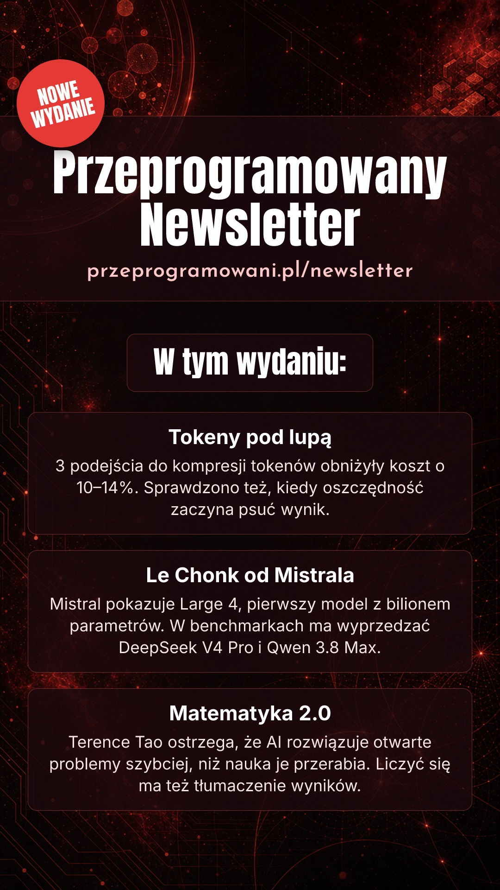

# przeprogramowani-insta-stories

Weekly Instagram Stories for our newsletters, generated and published from GitHub Actions.

| Newsletter | Source | When (Europe/Warsaw) | Workflow |
|---|---|---|---|
| Przeprogramowany Newsletter | Substack RSS (`przeprogramowani.substack.com/feed.xml`) | Sunday 09:00 (10:00 in summer) | `przeprogramowani.yml` |
| Opanuj.AI Newsletter | MailerLite campaigns (same selection as opanuj.ai/newsletter) | Tuesday 09:00 (10:00 in summer) | `opanuj-ai.yml` |



## How it works

1. **Latest issue** — `src/sources/` (Substack or MailerLite), picked per newsletter in `src/newsletters.mjs`. Substack blocks GitHub runners, so its feed is read through the Cloudflare Worker in `relay/`.
2. **Leads** — a text model (`openai/gpt-5.4-mini` via OpenRouter) writes 3 short Polish leads from the full issue.
3. **Background** — an image model (`openai/gpt-5.4-image-2` via OpenRouter) generates a text-free dark tech/space 9:16 background.
4. **Layout** — `src/layout.mjs` draws the template (badge, header + URL, "W tym wydaniu:", 3 cards) with Satori/resvg and bundled fonts, so Polish text is always exact. Output: 1080×1920 JPEG.
5. **Publish** — the Action uploads the image to S3 (served through CloudFront); Instagram's Graph API fetches it from there and posts it as a Story. `published.json` (the only thing the Action commits) prevents posting the same issue twice.

Leads and background are **cached per issue** (`actions/cache`): a retry or the real run after a dry run reuses them instead of paying again, and posts exactly the image you previewed. Tick `fresh` to generate a new version.

Adding a newsletter = one entry in `src/newsletters.mjs` (source, headline, URL, colours, voice) + a 20-line caller workflow.

## Setup

Repository secrets (Settings → Secrets and variables → Actions):

| Secret | What |
|---|---|
| `OPENROUTER_API_KEY` | OpenRouter key |
| `META_ACCESS_TOKEN` | Non-expiring Meta **Page** token with `instagram_content_publish` |
| `INSTAGRAM_USER_ID` | Instagram professional account ID linked to the Page |
| `MAILERLITE_API_KEY` | MailerLite API key (Opanuj.AI source) |
| `FEED_RELAY_TOKEN` | Shared token for the feed relay (same value as the Worker's `RELAY_TOKEN` secret) |
| `OPANUJ_AI_INSTAGRAM_USER_ID` | Optional — post Opanuj.AI Stories to a different IG account |
| `AWS_ACCESS_KEY_ID`, `AWS_SECRET_ACCESS_KEY`, `AWS_REGION` | IAM user allowed only `s3:PutObject` on `<bucket>/insta-stories/*` |
| `STORIES_S3_BUCKET`, `STORIES_CDN_BASE` | Bucket for the images and the CloudFront URL that serves it |

The Meta token's data access must be re-confirmed every 90 days; after regenerating it, update the secret.

## Running

- **Manually in GitHub:** Actions → pick the newsletter workflow → *Run workflow*. `dry_run` (default on for manual runs) generates and uploads the image and attaches it to the run, without posting; `fresh` regenerates leads/background instead of reusing the cached ones.
- **Locally** (Node 22, `.env` with the secrets above):

  ```bash
  npm ci
  node src/cli.mjs generate przeprogramowani   # → stories/przeprogramowani/<date>-<slug>.jpg
  FORCE=1 node src/cli.mjs generate opanuj-ai  # regenerate even if already published
  ```

  Publishing needs a public URL for the image, so it's meant to run in Actions.

- **Ad-hoc Story from your machine** — a thumbnail + a caption, posted right away (no AI calls, free):

  ```bash
  DRY_RUN=1 npm run custom -- przeprogramowani ~/Desktop/thumb.png "Nowy odcinek już jest!"   # preview only
  npm run custom -- przeprogramowani ~/Desktop/thumb.png "Nowy odcinek już jest!\nLink w bio"  # render, upload, post
  DRY_RUN=1 node src/cli.mjs reel przeprogramowani ~/Desktop/clip.mp4 "Opis rolki"   # check/prepare the video only
  node src/cli.mjs reel przeprogramowani ~/Desktop/clip.mp4 "Opis rolki" [cover.jpg]  # upload to S3, post as a Reel
  ```

  The image can be a path, an `https://` URL or `clipboard` (macOS: the copied image, or the image file copied in Finder); `\n` breaks the line and keeps each line whole; max 280
  chars. The first argument picks the brand colours, the logo and the Instagram account. The Story is
  rendered to `stories/custom/` (gitignored), uploaded with the aws CLI to S3 (`STORIES_S3_BUCKET`,
  served at `STORIES_CDN_BASE`), then published. Nothing is committed.
